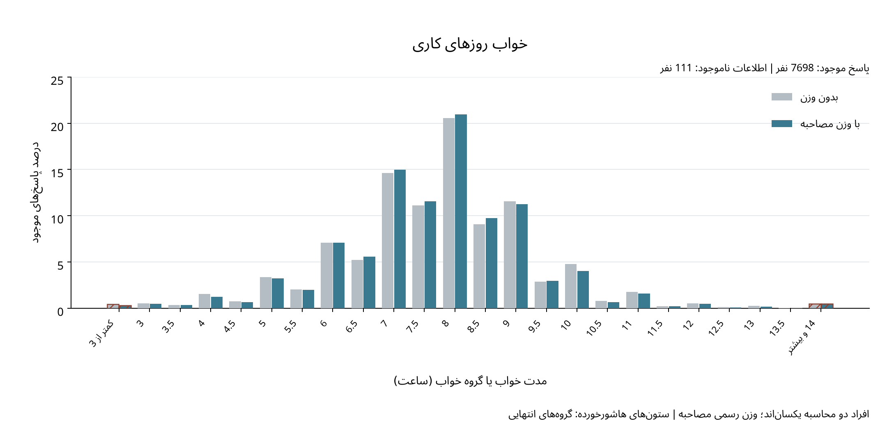
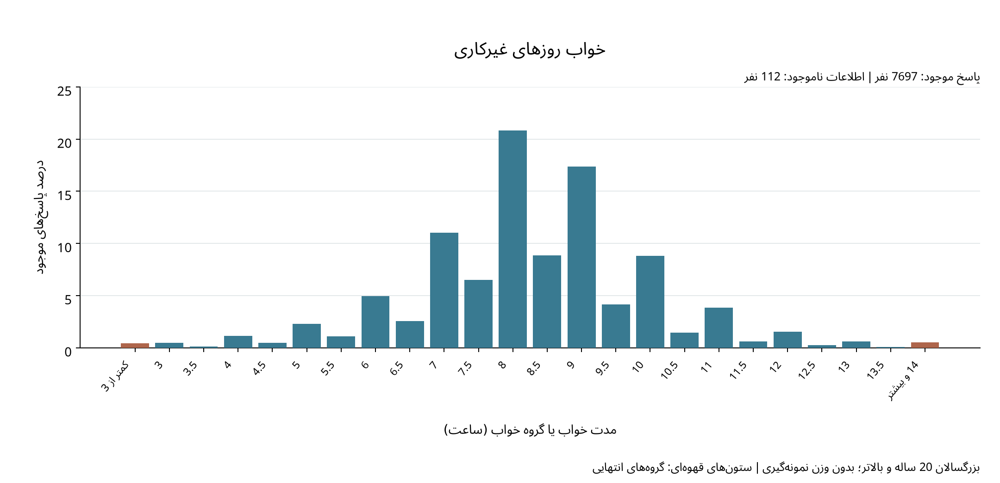
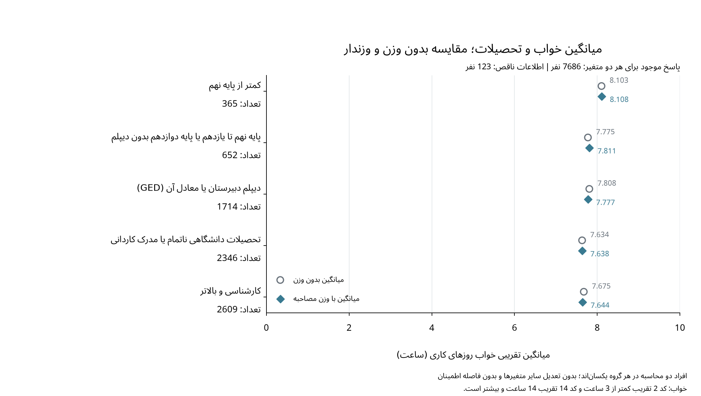
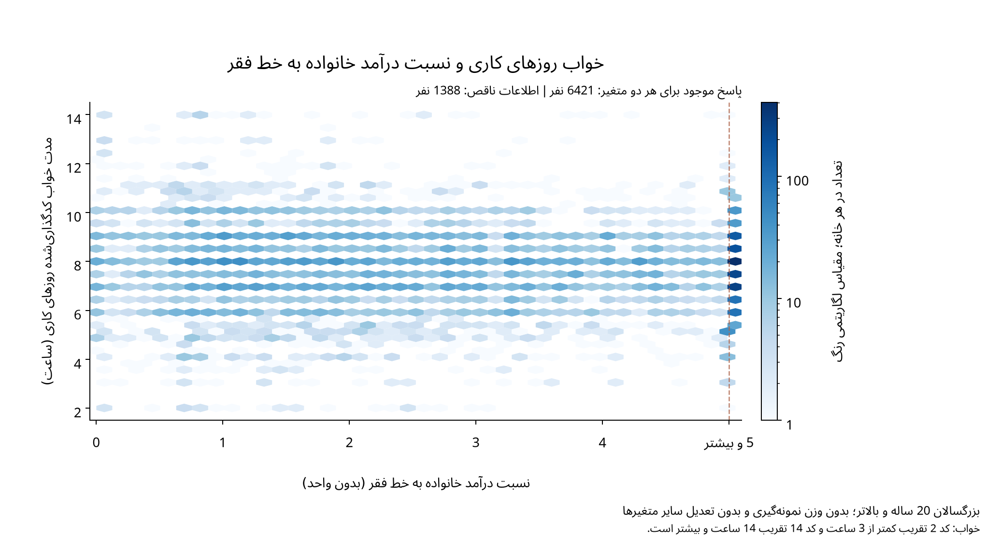
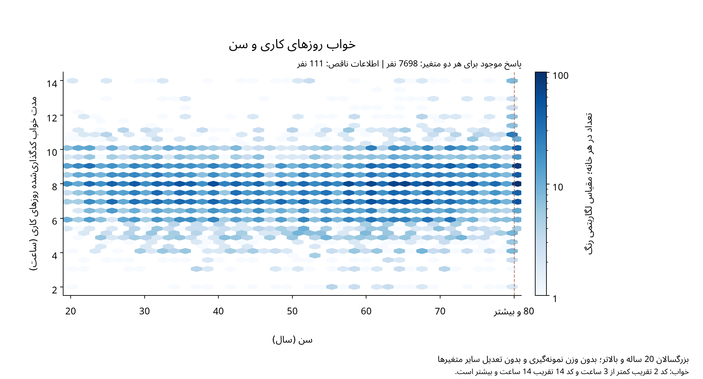
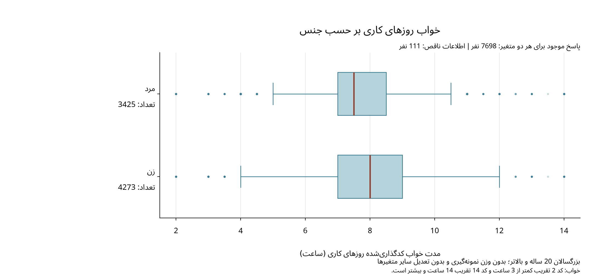
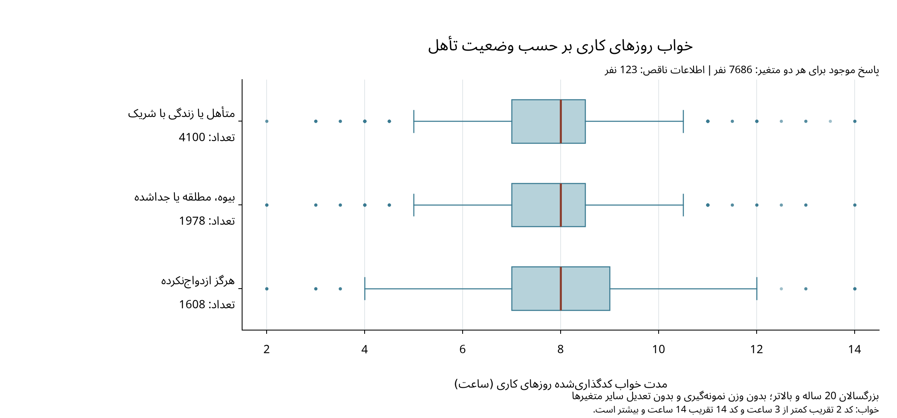

# گزارش فاز اول

## بررسی الگوهای مدت خواب در ارتباط با سطح تحصیلات و وضعیت اقتصادی، با در نظر گرفتن سن، جنس و وضعیت تأهل در بزرگسالان آمریکا

تحلیل داده‌های NHANES، اوت 2021 تا اوت 2023

### خلاصه

در این مطالعه مقطعی و مشاهده‌ای، توزیع مدت خواب را در ارتباط با تحصیلات و وضعیت اقتصادی و با توجه به سن، جنس و تأهل بررسی می‌کنیم. پس از اتصال اطلاعات جمعیت‌شناختی و خواب، 7809 فرد 20 ساله و بالاتر مشخص شدند و خلاصه‌های توصیفی با پاسخ‌های موجود هر متغیر محاسبه شدند؛ میانگین تقریبی خواب روزهای کاری 7.72 ساعت بدون وزن و 7.70 ساعت با وزن مصاحبه بود، درحالی‌که میانه خواب روزهای کاری و غیرکاری هر دو 8 ساعت بود. یافته‌های این مرحله توصیفی‌اند و بررسی رابطه‌ها پس از تعدیل هم‌زمان متغیرها به مراحل بعد مربوط است.

## 1. سؤال و طرح مطالعه

سؤال اصلی این است که در بزرگسالان 20 ساله و بالاترِ جمعیت غیرنظامی و غیرمؤسسه‌ای آمریکا، مدت خواب معمول روزهای کاری چه ارتباطی با سطح تحصیلات و نسبت درآمد خانواده به خط فقر دارد و با در نظر گرفتن سن، جنس و تأهل، این ارتباط‌ها چگونه تغییر می‌کنند؟ در این مرحله، بخش توصیفی سؤال را بررسی می‌کنیم و خواب روزهای غیرکاری را نیز به‌عنوان متغیر پاسخ تکمیلی در نظر می‌گیریم.

داده‌ها از پیمایش ملی سلامت و تغذیه آمریکا به دست آمده‌اند و واحد مشاهده یک فرد است؛ ازاین‌رو، مطالعه حاضر مشاهده‌ای است و افراد به گروه‌های آزمایشی تخصیص تصادفی نیافته‌اند. جامعه مورد نظر شامل بزرگسالان غیرنظامی است که در مراکز مؤسسه‌ای، مانند زندان و خانه سالمندان، زندگی نمی‌کنند و حد پایین سن 20 سال انتخاب شده است، زیرا اطلاعات تحصیلات بزرگسالان و تأهل برای این محدوده سنی منتشر شده‌اند. متغیر اقتصادی مطالعه نسبت درآمد خانواده به خط فقر است و نباید آن را معادل تمام ابعاد وضعیت اقتصادی، از جمله ثروت یا امنیت شغلی، دانست.

نمونه NHANES با طرح احتمالی چندمرحله‌ای، طبقه‌بندی‌شده و خوشه‌ای انتخاب شده است و احتمال انتخاب افراد یکسان نیست؛ بنابراین، توصیف بدون وزن به ترکیب نمونه مربوط است و برای برآورد ویژگی‌های جامعه باید وزن مناسب و محدودیت عدم پاسخ در نظر گرفته شود. در این دوره، نمونه‌گیری بیش از نسبت جمعیت بر اساس سن انجام شده است، اما نمونه‌گیری بیش از نسبت جمعیت بر اساس نژاد و منشأ اسپانیایی یا درآمد، مانند بعضی دوره‌های پیشین، انجام نشده است [1].

## 2. فایل‌ها، متغیرها و انتخاب نمونه

اطلاعات جمعیت‌شناختی، تحصیلات، تأهل، نسبت درآمد و وزن‌ها از `DEMO_L.xpt` و اطلاعات خواب از `SLQ_L.xpt` دریافت شدند و فایل‌ها با شناسه مشترک `SEQN` به‌صورت یک‌به‌یک به هم متصل شدند. این‌ها فایل‌های عمومی CDC/NCHS هستند که برای تحلیل و گزارش آماری منتشر شده‌اند و استفاده از آن‌ها تابع شرایط محرمانگی و منع شناسایی افراد است [4]. شناسه گمشده یا تکراری در هیچ فایل وجود نداشت و همه افراد فایل خواب در فایل جمعیت‌شناختی یافت شدند؛ همچنین، اتصال از سمت فایل جمعیت‌شناختی انجام شد تا افراد فاقد رکورد خواب پیش از بررسی کنار گذاشته نشوند.

| مرحله | تعداد |
| --- | --- |
| فایل جمعیت‌شناختی پیش از ادغام | 11933 |
| فایل خواب پیش از ادغام | 8501 |
| پس از اتصال از سمت فایل جمعیت‌شناختی | 11933 |
| افراد زیر 20 سال؛ خارج از جامعه مورد مطالعه | 4124 |
| افراد 20 ساله و بالاتر | 7809 |
| بزرگسالان دارای رکورد متناظر خواب | 7809 |

ردیف‌های این جدول مراحل یا شمارش‌های مرتبط‌اند و نباید با هم جمع شوند؛ پس از شرط سنی، همه بزرگسالان رکورد متناظر خواب داشتند، اما این موضوع به معنی کامل‌بودن پاسخ همه سؤال‌ها نبود. هیچ فردی صرفاً به دلیل ناقص‌بودن اطلاعات یک متغیر، از همه تحلیل‌های توصیفی حذف نشد.

| متغیر | نام ستون | نوع و نقش |
|---|---|---|
| مدت خواب روزهای کاری | `SLD012` | کمی پیوسته، ثبت‌شده با گردکردن نیم‌ساعته؛ متغیر پاسخ اصلی |
| مدت خواب روزهای غیرکاری | `SLD013` | کمی پیوسته، ثبت‌شده با گردکردن نیم‌ساعته؛ پاسخ تکمیلی |
| تحصیلات | `DMDEDUC2` | کیفی ترتیبی؛ متغیر توضیحی اصلی |
| نسبت درآمد به خط فقر | `INDFMPIR` | کمی و بدون واحد؛ متغیر توضیحی اصلی |
| سن | `RIDAGEYR` | کمی، ثبت‌شده به سال کامل؛ متغیر توضیحی برای تعدیل |
| جنس | `RIAGENDR` | کیفی اسمی، مرد و زن؛ متغیر توضیحی برای تعدیل |
| وضعیت تأهل | `DMDMARTZ` | کیفی اسمی با سه گروه؛ متغیر توضیحی برای تعدیل |

سن 80 شامل افراد 80 ساله و بالاتر و نسبت درآمد 5 شامل مقادیر 5 و بیشتر است، درحالی‌که تحصیلات پنج سطح و تأهل سه گروه منتشرشده دارد [1]. این محدودیت‌ها در خلاصه‌های عددی و برچسب نمودارها حفظ شده‌اند و برای سن یا درآمد گروه‌بندی تازه‌ای تعریف نشده است.

## 3. کیفیت داده‌ها و تصمیم‌های آماده‌سازی

کدهای 7 و 9 تحصیلات و 77 و 99 تأهل به معنی امتناع از پاسخ یا ندانستن پاسخ‌اند و در محاسبات، اطلاعات ناموجود محسوب شدند؛ درعین‌حال، مقادیر خام بدون تغییر نگهداری شدند. بررسی دامنه‌ها و کدهای مجاز، مقدار خارج از تعریف متغیرهای اصلی نشان نداد، هرچند این بررسی وجود خطای اندازه‌گیری یا یادآوری را رد نمی‌کند.

| متغیر | تعداد ناموجود | درصد |
| --- | --- | --- |
| سن | 0 | 0.00 |
| جنس | 0 | 0.00 |
| تحصیلات | 26 | 0.33 |
| وضعیت تأهل | 26 | 0.33 |
| نسبت درآمد به خط فقر | 1320 | 16.90 |
| خواب روزهای کاری | 111 | 1.42 |
| خواب روزهای غیرکاری | 112 | 1.43 |

مخرج درصدهای این جدول 7809 بزرگسال است و محاسبات بدون وزن انجام شده‌اند. از آنجا که نسبت درآمد برای 16.9 درصد افراد موجود نیست، حذف همه افراد دارای هر نوع اطلاعات ناقص باعث از دست رفتن پاسخ‌های قابل استفاده آن‌ها در سایر متغیرها می‌شد؛ بنابراین، هر خلاصه با اطلاعات موجود همان متغیر و هر مقایسه با اطلاعات موجود همان دو متغیر محاسبه شده و مخرج آن مشخص است. هیچ داده گمشده‌ای با صفر یا میانگین جایگزین نشده است و روش برخورد با اطلاعات ناقص در رگرسیون هنوز نهایی نشده است.

مدت خواب از زمان‌های گزارش‌شده خواب و بیداری محاسبه و به نیم‌ساعت گرد شده است، اما کد 2 به معنی «کمتر از 3 ساعت» و کد 14 به معنی «14 ساعت و بیشتر» است [2]. برای روزهای کاری، 33 نفر در گروه اول و 36 نفر در گروه دوم قرار دارند و چون زمان دقیق همه آن‌ها قابل بازیابی نیست، در جدول فراوانی عنوان گروه‌ها حفظ شده و در خلاصه عددی، کدهای منتشرشده به‌عنوان تقریب به کار رفته‌اند؛ در کنار آن، محاسبات بدون این دو گروه نیز گزارش شده است تا حساسیت نتیجه به این انتخاب روشن شود.

## 4. آمار توصیفی

### 4ـ1. متغیرهای کمی

| متغیر | تعداد پاسخ | میانگین | میانه | انحراف معیار | چارک اول | چارک سوم | دامنه میان‌چارکی |
| --- | --- | --- | --- | --- | --- | --- | --- |
| خواب روزهای کاری؛ ساعت | 7698 | 7.72 | 8.00 | 1.61 | 7.00 | 8.50 | 1.50 |
| خواب روزهای غیرکاری؛ ساعت | 7697 | 8.27 | 8.00 | 1.71 | 7.50 | 9.00 | 1.50 |
| سن ثبت‌شده؛ سال | 7809 | 53.63 | 57.00 | 17.53 | 38.00 | 68.00 | 30.00 |
| نسبت درآمد ثبت‌شده | 6489 | 2.90 | 2.79 | 1.66 | 1.40 | 4.97 | 3.57 |

این جدول بدون وزن است و میانگین و پراکندگی سن و درآمد به مقادیر دارای حد بالای انتشار مربوط‌اند، نه مقادیر دقیق بدون آن محدودیت‌ها؛ میانگین خواب نیز خلاصه متغیر کدگذاری‌شده است. انحراف معیار نمونه با مخرج واریانس برابر تعداد مشاهدات منهای یک، چارک‌ها با درون‌یابی خطی داده‌های مرتب‌شده و دامنه میان‌چارکی از اختلاف چارک سوم و اول محاسبه شده‌اند. میانگین از همه مقادیر استفاده می‌کند و به انتهای توزیع حساس است، درحالی‌که میانه و دامنه میان‌چارکی مرکز و پراکندگی بخش میانی را نشان می‌دهند و برای داده‌های گرد‌شده یا دارای مقادیر انتهایی، مکمل مفیدی هستند.

میانه خواب هر دو نوع روز 8 ساعت است، اما چارک سوم خواب روزهای غیرکاری به 9 ساعت می‌رسد و از چارک سوم روزهای کاری، یعنی 8.5 ساعت، بالاتر است؛ بااین‌حال، میانگین‌های دو نوع روز از مجموعه پاسخ‌های کاملاً یکسان محاسبه نشده‌اند و تفاوت آن‌ها تغییر خواب هر فرد را نشان نمی‌دهد.

### 4ـ2. متغیرهای کیفی

| متغیر | گروه | فراوانی | درصد |
| --- | --- | --- | --- |
| جنس | مرد | 3488 | 44.67 |
| جنس | زن | 4321 | 55.33 |
| تحصیلات | کمتر از پایه نهم | 373 | 4.79 |
| تحصیلات | پایه نهم تا یازدهم یا پایه دوازدهم بدون دیپلم | 666 | 8.56 |
| تحصیلات | دیپلم دبیرستان یا معادل آن (GED) | 1749 | 22.47 |
| تحصیلات | تحصیلات دانشگاهی ناتمام یا مدرک کاردانی | 2370 | 30.45 |
| تحصیلات | کارشناسی و بالاتر | 2625 | 33.73 |
| وضعیت تأهل | متأهل یا زندگی با شریک | 4136 | 53.14 |
| وضعیت تأهل | بیوه، مطلقه یا جداشده | 2022 | 25.98 |
| وضعیت تأهل | هرگز ازدواج‌نکرده | 1625 | 20.88 |

درصدهای هر متغیر از پاسخ‌های موجود همان متغیر محاسبه شده‌اند؛ برای جنس، مخرج 7809 نفر و برای تحصیلات و تأهل، مخرج 7783 نفر است. در نمونه، گروه کارشناسی و بالاتر بیشترین فراوانی تحصیلات را دارد و گروه متأهل یا زندگی با شریک نیز از هر یک از دو گروه تأهل دیگر بزرگ‌تر است، اما این درصدهای بدون وزن را نباید مستقیماً درصدهای جامعه آمریکا دانست.

## 5. نمودارها و مقایسه‌های اولیه

### 5ـ1. توزیع خواب

<figure><figcaption>شکل 1. درصدهای بدون وزن و وزندار خواب روزهای کاری؛ دو گروه انتهایی با عنوان خود و هاشور نمایش داده شده‌اند.</figcaption></figure>

<figure><figcaption>شکل 2. توزیع بدون وزن خواب روزهای غیرکاری؛ مقیاس درصد با شکل اول یکسان است.</figcaption></figure>

به دلیل گردکردن نیم‌ساعته و وجود گروه‌های باز در انتهای توزیع، از نمودار ستونی استفاده کرده‌ایم تا عنوان این گروه‌ها حفظ شود؛ محور افقی شامل مقادیر و گروه‌های مرتب‌شده است و پهنای یکسان ستون‌ها به معنی بازه‌های هم‌عرض خواب نیست. مقدار 8 ساعت در هر دو توزیع بدون وزن بیشترین فراوانی را دارد و در روزهای غیرکاری، سهم پاسخ‌های 9 و 10 ساعت بیشتر است؛ برای مقایسه دو نوع روز باید ستون‌های بدون وزن را با هم مقایسه کرد.

### 5ـ2. خواب و تحصیلات

<figure><figcaption>شکل 3. میانگین تقریبی خواب در پنج سطح تحصیلات؛ نقاط دو روش به افراد یکسان هر گروه مربوط‌اند و فاصله اطمینان ندارند.</figcaption></figure>

نمودار میانگین‌ها را انتخاب کرده‌ایم تا نقش وزن‌دهی در رابطه توصیفی یکی از متغیرهای اصلی سؤال دیده شود، درحالی‌که نمودار جعبه‌ای تحصیلات برای بررسی میانه و پراکندگی در فایل پشتیبان باقی مانده است. میانگین وزندار خواب در پایین‌ترین سطح تحصیلات 8.11 ساعت و در کارشناسی و بالاتر 7.64 ساعت است، اما الگو در همه سطوح کاملاً یکنواخت نیست و بدون تعدیل سن و سایر متغیرها نمی‌توان این تفاوت را اثر مستقل تحصیلات دانست.

### 5ـ3. خواب، درآمد و سن

<figure><figcaption>شکل 4. تراکم مشاهدات خواب و نسبت درآمد؛ مقدار 5 نماینده 5 و بیشتر است.</figcaption></figure>

<figure><figcaption>شکل 5. تراکم مشاهدات خواب و سن؛ مقدار 80 نماینده افراد 80 ساله و بالاتر است.</figcaption></figure>

برای جلوگیری از پوشیده‌شدن نقاط هم‌مقدار از خانه‌های شش‌ضلعی استفاده شده است و رنگ، تعداد مشاهدات هر خانه را با مقیاس لگاریتمی نشان می‌دهد؛ بااین‌حال، محورهای متغیرها خطی‌اند و لگاریتم‌گیری یا گروه‌بندی تحلیلی تازه‌ای انجام نشده است. تمرکز مشاهدات عمدتاً در مقادیر میانی خواب دیده می‌شود و در سن 80 و نسبت درآمد 5 نیز تجمع ناشی از حد بالای انتشار وجود دارد؛ بنابراین، تیرگی این بخش‌ها را نباید احتمال شرطی یا میانگین خواب در آن سن یا درآمد دانست.

### 5ـ4. خواب، جنس و تأهل

<figure><figcaption>شکل 6. نمودار جعبه‌ای بدون وزن خواب بر حسب جنس؛ تعداد افراد دارای هر دو پاسخ کنار گروه آمده است.</figcaption></figure>

<figure><figcaption>شکل 7. نمودار جعبه‌ای بدون وزن خواب بر حسب وضعیت تأهل؛ نقاط بیرون سبیل‌ها نمایش داده شده‌اند و حذف نشده‌اند.</figcaption></figure>

نمودار جعبه‌ای امکان مقایسه میانه و پراکندگی را فراهم می‌کند؛ خط داخل جعبه میانه، دو انتهای جعبه چارک‌ها و سبیل‌ها دورترین مشاهدات در فاصله حداکثر 1.5 برابر دامنه میان‌چارکی از چارک‌ها هستند. در نمونه، میانه خواب مردان 7.5 و زنان 8 ساعت است، درحالی‌که میانه هر سه گروه تأهل 8 ساعت است و پراکندگی آن‌ها کاملاً یکسان نیست؛ از سوی دیگر، هم‌پوشانی جعبه‌ها یا تفاوت آن‌ها به‌تنهایی آزمون معنی‌داری نیست.

تعداد پاسخ‌های مشترک برای نمودار تحصیلات و تأهل هر کدام 7686 نفر، برای سن و جنس هر کدام 7698 نفر و برای نسبت درآمد 6421 نفر است؛ به همین دلیل، تفاوت حجم نمودارها به اطلاعات مورد نیاز همان مقایسه مربوط است و همه آن‌ها بدون تعدیل سایر متغیرها تفسیر می‌شوند.

## 6. وزن‌دهی و تحلیل حساسیت

وزن مصاحبه `WTINT2YR` توسط NCHS و بر اساس احتمال انتخاب، عدم پاسخ در سطح پیمایش و تطبیق با جمعیت ساخته شده است و چون متغیرهای فعلی از مصاحبه به دست آمده‌اند، این وزن به‌جای وزن معاینه استفاده شده است [1، 3]. همه بزرگسالان وزن مثبت و اطلاعات موجود درباره طبقه و واحد نمونه‌گیری اولیه دارند و میانگین وزندار از مجموع حاصل‌ضرب وزن در خواب، تقسیم بر مجموع وزن همان افراد، به دست آمده است؛ وزن‌دهی با تعدیل رابطه‌ها برای سن یا جنس در رگرسیون متفاوت است.

| روش | تعداد پاسخ | بدون وزن؛ ساعت | وزندار؛ ساعت |
| --- | --- | --- | --- |
| تقریب کدهای منتشرشده | 7698 | 7.720 | 7.705 |
| بدون دو گروه انتهایی | 7629 | 7.716 | 7.692 |

در ردیف اصلی، اختلاف وزندار و بدون وزن حدود 0.95 دقیقه کاهش است و در شکل تحصیلات، تغییر میانگین‌ها بر اثر وزن‌دهی از حدود -1.85 تا 2.19 دقیقه است. برای آنکه تفاوت وزن‌دهی با تغییر نمونه مخلوط نشود، در هر ردیف افراد دو روش یکسان‌اند و در محاسبه بدون دو گروه انتهایی نیز وزن‌های رسمی افراد باقی‌مانده تغییر نکرده‌اند.

با کنارگذاشتن دو گروه انتهایی، میانگین وزندار از 7.705 به 7.692 ساعت می‌رسد، درحالی‌که در خلاصه بدون وزن، میانه و چارک‌های خواب تغییر نمی‌کنند و انحراف معیار کاهش می‌یابد. این مقایسه حساسیت خلاصه‌ها را نشان می‌دهد، اما مقدار واقعی خواب گروه‌های انتهایی را بازیابی نمی‌کند و محاسبه دوم نیز گروه محدودتری از افراد را توصیف می‌کند؛ همچنین، کوچک‌بودن تغییر میانگین کلی، پایداری همه مقایسه‌های گروهی یا مدل‌های بعدی را تضمین نمی‌کند.

برای فاصله اطمینان و آزمون‌های مراحل بعد، علاوه بر وزن‌ها باید طبقه `SDMVSTRA` و واحد نمونه‌گیری اولیه `SDMVPSU` نیز لحاظ شوند و در این مرحله چنین استنباطی انجام نشده است.

## 7. محدودیت‌ها و تناسب داده با سؤال

داده‌ها مقطعی و مشاهده‌ای‌اند و ازاین‌رو، تفاوت خواب میان سطوح تحصیلات یا درآمد رابطه علّی را اثبات نمی‌کند؛ همچنین، عواملی مانند شغل، شیفت کاری و وضعیت سلامت ممکن است با رابطه‌های مشاهده‌شده همراه باشند و هنوز در تحلیل حاضر وارد نشده‌اند. مدت خواب از زمان‌های گزارش‌شده به دست آمده و ممکن است خطای یادآوری داشته باشد، درحالی‌که لزوماً خواب کل شبانه‌روز و چرت‌زدن را پوشش نمی‌دهد [2].

گردکردن خواب و ثبت گروهی مقادیر انتهایی خواب، سن و درآمد، تفسیر خلاصه‌های عددی را محدود می‌کند؛ علاوه بر این، اطلاعات اقتصادی ناموجود می‌تواند ترکیب پاسخ‌دهندگان تحلیل‌های مرتبط با درآمد را تغییر دهد و وزن رسمی نیز عدم پاسخ به یک سؤال مشخص را خودبه‌خود جبران نمی‌کند [3]. تعداد متفاوت افراد گروه‌ها و طرح خوشه‌ای نمونه‌گیری نیز در ارزیابی دقت برآوردهای مراحل بعد اهمیت دارند و تنها با مشاهده نمودار یا محاسبه میانگین نمی‌توان عدم قطعیت را تعیین کرد.

بااین‌حال، هر دو فایل متغیرهای لازم برای مقایسه تحصیلات و وضعیت اقتصادی با خواب را در بزرگسالان دارند و شناسه مشترک، وزن و متغیرهای طرح نیز موجودند؛ بنابراین، داده‌ها برای ادامه بررسی سؤال مناسب‌اند، مشروط بر آنکه محدودیت‌های فوق و روش برخورد با اطلاعات ناقص در مراحل بعد لحاظ شوند. نتیجه این مرحله، شناخت نمونه و تفاوت‌های توصیفی است و هنوز پاسخی درباره رابطه‌ها پس از تعدیل هم‌زمان سن، جنس و تأهل ارائه نمی‌کند.

## منابع

1. CDC/NCHS. [متغیرهای جمعیت‌شناختی و وزن‌های NHANES اوت 2021 تا اوت 2023](https://wwwn.cdc.gov/Nchs/Data/Nhanes/Public/2021/DataFiles/DEMO_L.htm).

2. CDC/NCHS. [متغیرهای خواب و روش محاسبه مدت خواب](https://wwwn.cdc.gov/Nchs/Data/Nhanes/Public/2021/DataFiles/SLQ_L.htm).

3. CDC/NCHS. [راهنمای وزن‌دهی NHANES](https://wwwn.cdc.gov/nchs/nhanes/tutorials/weighting.aspx).

4. CDC/NCHS. [شرایط استفاده از داده‌های عمومی](https://www.cdc.gov/nchs/policy/data-user-agreement.html).

## فایل‌های پشتیبان

روش بازتولید در `README.md` و منبع و دریافت داده‌ها در `data/README.md` آمده است؛ همچنین، جدول‌های تفصیلی کیفیت، خلاصه‌های عددی و وزن‌دهی در `reports/phase1/` و نسخه مستقل نمودارها در `figures/phase1/` قرار دارند.
