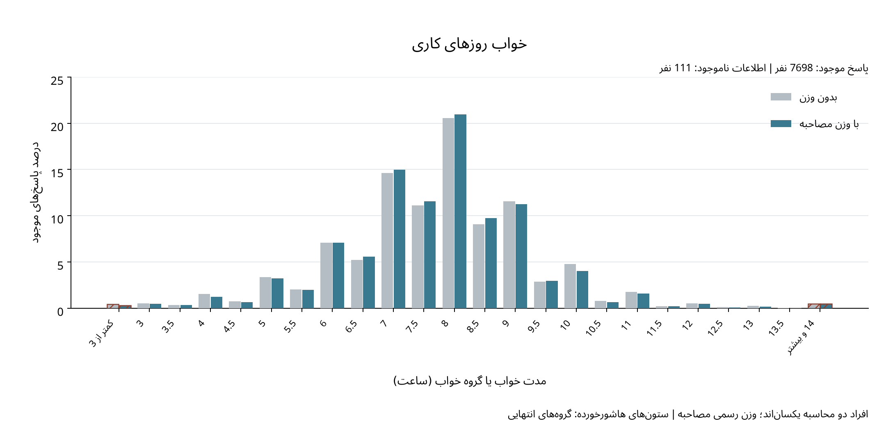
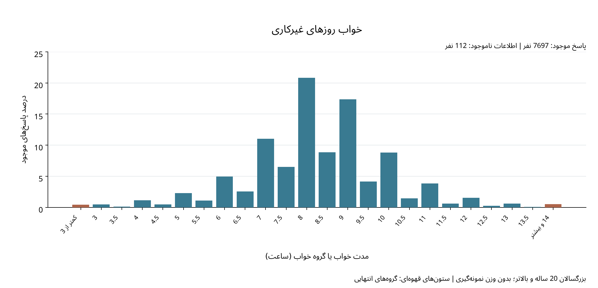

# توزیع مدت خواب در روزهای کاری و غیرکاری

برای بررسی شکل توزیع خواب، درصد پاسخ‌های موجود افراد 20 ساله و بالاتر را در دو نمودار با مقیاس عمودی یکسان نشان داده‌ایم؛ در نمودار روزهای کاری، درصدهای بدون وزن و با وزن رسمی مصاحبه کنار هم آمده‌اند تا نقش وزن‌دهی مستقیماً دیده شود، درحالی‌که نمودار روزهای غیرکاری توصیف بدون وزن نمونه را نشان می‌دهد.

## انتخاب نمودار و مقیاس‌ها

چون داده‌های خواب به نزدیک‌ترین نیم‌ساعت گرد شده‌اند و در دو انتهای توزیع نیز گروه‌های باز «کمتر از 3 ساعت» و «14 ساعت و بیشتر» وجود دارند، از نمودار ستونی فراوانی نسبی استفاده کرده‌ایم تا این دو گروه با عنوان واقعی خود باقی بمانند. محور افقی شامل مقادیر و گروه‌های مرتب‌شده است و پهنای یکسان ستون‌ها به معنی پهنای یکسان بازه‌های خواب نیست؛ در نتیجه، این شکل هیستوگرام با بازه‌های پیوسته و هم‌عرض نیست.

در نمودار روزهای کاری، ستون خاکستری درصد بدون وزن و ستون آبی درصد با وزن `WTINT2YR` را نشان می‌دهد و دو گروه انتهایی هاشور خورده‌اند؛ در نمودار روزهای غیرکاری نیز دو گروه انتهایی قهوه‌ای هستند. مخرج درصد بدون وزن تعداد پاسخ‌های موجود و مخرج درصد وزندار مجموع وزن همان پاسخ‌دهندگان است، بنابراین افراد دو محاسبه یکسان‌اند و برای رسم شکل نیازی به تفسیر کدهای 2 و 14 به‌عنوان زمان دقیق نداریم. محور عمودی هر دو نمودار از صفر شروع می‌شود و حد بالای یکسانی دارد تا تغییر مقیاس بر مقایسه اثر نگذارد.

## خواب روزهای کاری



## خواب روزهای غیرکاری



## برداشت توصیفی

| متغیر | نما؛ ساعت | فراوانی نما | درصد پاسخ‌های موجود |
| --- | --- | --- | --- |
| خواب روزهای کاری | 8 | 1583 | 20.56 |
| خواب روزهای غیرکاری | 8 | 1602 | 20.81 |

جدول بالا خلاصه بدون وزن دو متغیر را نشان می‌دهد و در هر دو، 8 ساعت نماست؛ همچنین، ستون‌های روزهای کاری امکان بررسی تغییر سهم هر مقدار پس از وزن‌دهی را فراهم می‌کنند، بدون آنکه شکل ظاهری نمودار را آزمون فرض بدانیم. برای مقایسه نوع روزها باید ستون‌های بدون وزن را با هم مقایسه کرد، زیرا نمودار روزهای غیرکاری در این مجموعه وزندار نیست.

این دو نمودار توزیع‌های حاشیه‌ای را نشان می‌دهند و چون مجموعه پاسخ‌دهندگان دو متغیر کاملاً یکسان نیست، تفاوت آن‌ها به معنی محاسبه تغییر خواب هر فرد نیست؛ برای چنین مقایسه‌ای باید تنها افراد دارای هر دو پاسخ را در نظر بگیریم و اختلاف خواب را برای هر فرد محاسبه کنیم. همچنین، شکل نمودارها به‌تنهایی برای تأیید یک توزیع نرمال یا نتیجه‌گیری درباره معنی‌داری تفاوت‌ها کافی نیست و در این مرحله آزمون فرض انجام نشده است.

## فایل‌ها و اجرای دوباره

جدول [فراوانی پاسخ‌ها](sleep_distribution_frequencies.csv) و [درصدهای بدون وزن و وزندار روزهای کاری](weekday_distribution_weight_comparison.csv) مبنای نمودارها هستند؛ جزئیات محیط اجرا در راهنمای داده‌ها آمده است.

```sh
.venv/bin/python src/plot_sleep_distributions.py
```
