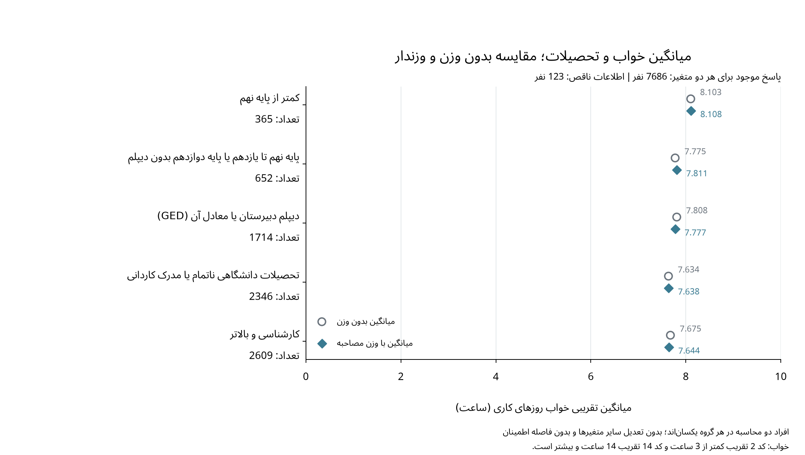
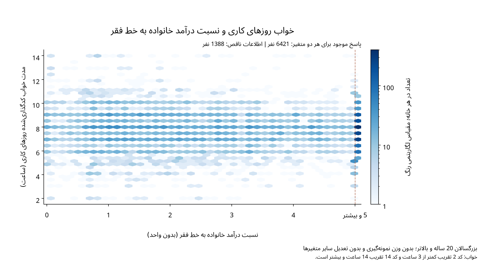
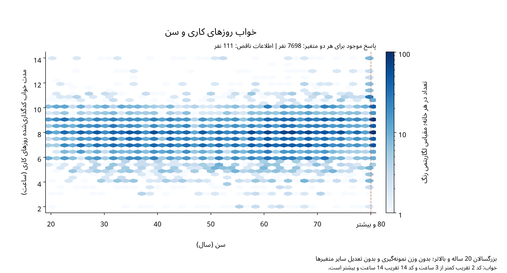
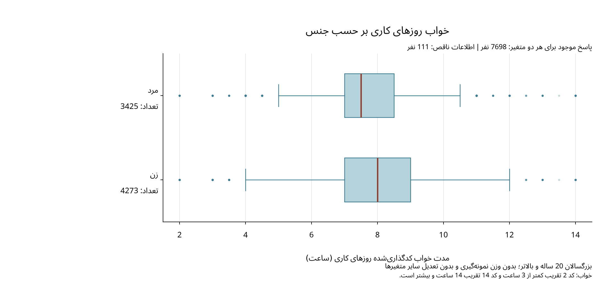
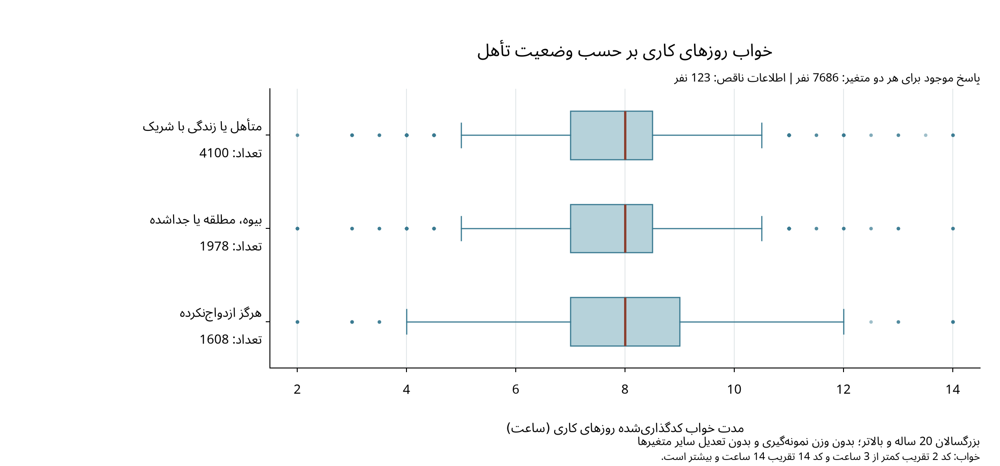

# خواب روزهای کاری و متغیرهای توضیحی

چون مدت خواب روزهای کاری متغیر پاسخ اصلی مطالعه است، رابطه توصیفی آن را با تحصیلات، نسبت درآمد به خط فقر، سن، جنس و وضعیت تأهل نشان داده‌ایم؛ این مقایسه‌ها دو متغیره‌اند و سایر متغیرها در آن‌ها تعدیل نشده‌اند.

## نمونه هر نمودار

| متغیر توضیحی | تعداد واردشده در نمودار | اطلاعات ناقص در دست‌کم یکی از دو متغیر |
| --- | --- | --- |
| تحصیلات | 7686 | 123 |
| نسبت درآمد خانواده به خط فقر | 6421 | 1388 |
| سن | 7698 | 111 |
| جنس | 7698 | 111 |
| وضعیت تأهل | 7686 | 123 |

در هر مقایسه، فقط پاسخ‌های موجود همان دو متغیر وارد نمودار شده‌اند و کدهای امتناع از پاسخ و ندانستن پاسخ در تحصیلات و تأهل، پاسخ موجود محسوب نشده‌اند؛ بنابراین، گمشدگی درآمد باعث حذف فرد از نمودار تحصیلات یا جنس نشده است. در نمودار تحصیلات، میانگین بدون وزن و با وزن مصاحبه روی افراد یکسان هر گروه مقایسه می‌شوند، درحالی‌که چهار نمودار دیگر توصیف بدون وزن نمونه‌اند و هیچ‌کدام برای سایر متغیرها تعدیل نشده‌اند.

## دلیل انتخاب نمودارها

برای تحصیلات از نمودار نقطه‌ای میانگین‌های بدون وزن و وزندار استفاده کرده‌ایم تا نقش وزن‌دهی در مقایسه گروه‌ها دیده شود؛ محور از صفر آغاز می‌شود و نقاط، میانگین تقریبی هر گروه را نشان می‌دهند، نه مقدار خواب افراد یا فاصله اطمینان. برای بررسی میانه و پراکندگی نیز [نمودار جعبه‌ای تحصیلات](../../figures/phase1/supporting/education_boxplot.pdf) در دسترس است.

برای جنس و وضعیت تأهل، نمودار جعبه‌ای را حفظ کرده‌ایم تا مقایسه مرکز و پراکندگی نمونه نیز در مجموعه باقی بماند؛ خط داخل جعبه میانه، دو انتهای آن چارک‌ها و سبیل‌ها دورترین مقادیر در فاصله حداکثر 1.5 برابر دامنه میان‌چارکی از چارک‌ها را نشان می‌دهند. نقاط بیرون سبیل‌ها حذف نشده‌اند، اما چون بعضی نقاط روی هم قرار می‌گیرند، تعداد افراد هر گروه جداگانه نوشته شده است.

برای سن و نسبت درآمد از نمایش تراکم نقاط با خانه‌های شش‌ضلعی استفاده کرده‌ایم، زیرا تعداد زیاد مشاهدات و ثبت خواب در نیم‌ساعت‌ها باعث هم‌پوشانی نقاط می‌شود؛ در این نمایش، تیرگی رنگ تعداد مشاهدات هر خانه را نشان می‌دهد و راهنمای رنگ هر نمودار نیز همین تعداد را مشخص می‌کند. مقیاس رنگ لگاریتمی است تا خانه‌های کم‌جمعیت در کنار خانه‌های پرتراکم قابل مشاهده بمانند، اما محورهای سن، درآمد و خواب خطی‌اند و هیچ مقداری برای تحلیل لگاریتم‌گیری نشده است. این خانه‌بندی صرفاً برای نمایش است و متغیرها را برای تحلیل به گروه‌های تازه تبدیل نمی‌کند؛ همچنین، رنگ‌ها فراوانی مطلق‌اند و احتمال شرطی یا میانگین خواب در هر سن یا سطح درآمد را نشان نمی‌دهند.

در پنج نمودار، کدهای 2 و 14 خواب به‌عنوان تقریب عددی به کار رفته‌اند و این فرض زیر شکل‌ها نوشته شده است، درحالی‌که مقادیر 80 سن و 5 نسبت درآمد با عنوان «و بیشتر» مشخص شده‌اند. چهار نمودار افراد، مقیاس خواب یکسان دارند و مقادیر انتهایی را نیز نشان می‌دهند، اما نمودار تحصیلات محور میانگین گروه‌هاست و نباید دامنه آن را دامنه خواب افراد دانست.

## خواب و تحصیلات



## خواب و نسبت درآمد خانواده به خط فقر



## خواب و سن



## خواب و جنس



## خواب و وضعیت تأهل



## جدول‌های پشتیبان

[خلاصه عددی گروه‌ها](sleep_by_group_summaries.csv) و [تحلیل حساسیت میانگین‌های وزندار](weighted_descriptive_comparisons.md) برای بررسی بیشتر در دسترس‌اند.

## دامنه تفسیر

هم‌پوشانی جعبه‌ها یا تفاوت ارتفاع و تیرگی بخش‌های نمودار، به‌تنهایی آزمون فرض نیست و از آن نمی‌توان درباره معنی‌داری آماری یا رابطه علّی نتیجه گرفت؛ افزون بر این، ممکن است بخشی از تفاوت مشاهده‌شده میان گروه‌های تحصیلی یا اقتصادی با تفاوت ترکیب سنی، جنسی یا تأهل آن‌ها همراه باشد، که بررسی هم‌زمان آن‌ها به مرحله رگرسیون چندگانه مربوط است.

## مجموعه کامل و اجرای دوباره

[مجموعه نمودارها](../../figures/phase1/all_seven_plots.pdf) با دستور زیر بازتولید می‌شود و جزئیات محیط اجرا در راهنمای داده‌ها آمده است:

```sh
.venv/bin/python src/plot_sleep_relationships.py
```
