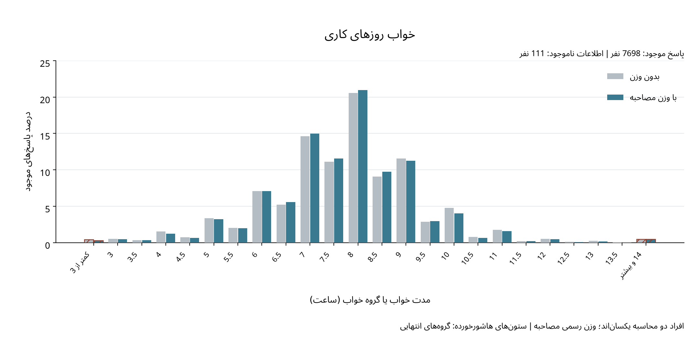
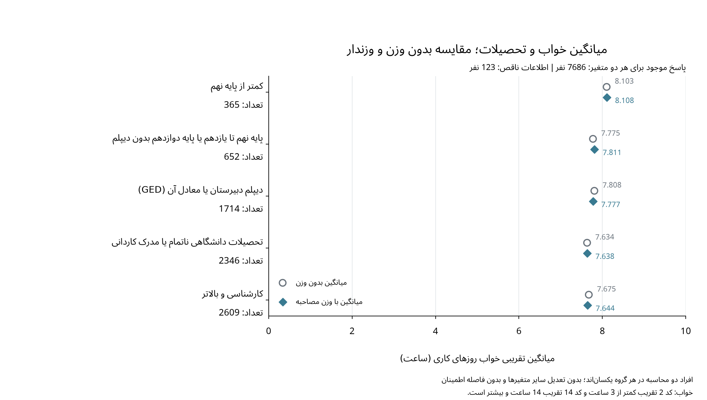

# نقش وزن نمونه‌گیری در توصیف خواب

وزن‌دهی را در توزیع خواب روزهای کاری و میانگین خواب بر حسب تحصیلات بررسی می‌کنیم تا هم تغییر سهم مقادیر خواب و هم رابطه توصیفی آن با متغیر توضیحی اصلی مطالعه مشخص شود.

## روش و نتیجه اصلی

از وزن مصاحبه `WTINT2YR` استفاده کرده‌ایم که NCHS برای هر شرکت‌کننده منتشر کرده است، زیرا متغیرهای مطالعه از مصاحبه به دست آمده‌اند و نیازی به وزن معاینه ندارند. درصد وزندار هر مقدار خواب برابر سهم وزن پاسخ‌دهندگان آن مقدار از مجموع وزن پاسخ‌های موجود است و میانگین وزندار نیز از تقسیم مجموع حاصل‌ضرب وزن در خواب بر مجموع وزن همان افراد به دست می‌آید؛ بنابراین، افراد دو محاسبه در هر مقایسه یکسان‌اند و تفاوت نتیجه فقط به شیوه وزن‌دهی مربوط است.

در 7698 پاسخ موجود، میانگین تقریبی خواب روزهای کاری از 7.720 ساعت بدون وزن به 7.705 ساعت وزندار می‌رسد و تغییر آن -0.946 دقیقه است. در پنج سطح تحصیلات، تغییر میانگین بر اثر وزن‌دهی از -1.85 تا 2.19 دقیقه است؛ بااین‌حال، کوچک‌بودن این تغییرها در مقایسه‌های فعلی به معنی بی‌نیازی از وزن‌دهی در مراحل بعد نیست.

## دو نمودار منتخب





در نمودار اول، دو گروه انتهایی با عنوان خود و به‌صورت هاشورخورده مشخص شده‌اند، اما میانگین‌های نمودار دوم کدهای 2 و 14 را به‌عنوان تقریب به کار می‌برند؛ به همین دلیل، [تحلیل حساسیت](weighted_sleep_comparison.md) و محاسبات درون گروه‌ها نیز در [گزارش پشتیبان](weighted_descriptive_comparisons.md) نگهداری شده‌اند. این مقایسه‌ها برای سن، جنس و تأهل تعدیل نشده‌اند و فاصله اطمینان یا آزمون فرض ندارند، درحالی‌که وزن رسمی نیز پاسخ‌های گمشده به سؤال مشخص را خودبه‌خود جبران نمی‌کند.

## منبع و بازتولید

مبنای انتخاب وزن، [راهنمای رسمی وزن‌دهی NHANES](https://wwwn.cdc.gov/nchs/nhanes/tutorials/weighting.aspx) است؛ برای بازتولید محاسبات و نمودارها، به‌ترتیب دو دستور زیر را اجرا می‌کنیم:

```sh
.venv/bin/python src/compare_all_weights.py
.venv/bin/python src/plot_sleep_relationships.py
```
