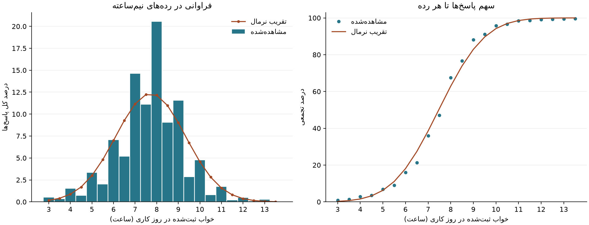
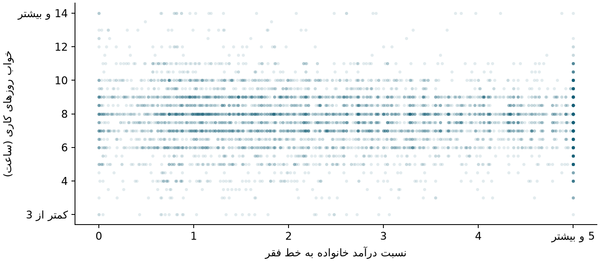

# احتمال و توزیع مدت خواب در ارتباط با تحصیلات و وضعیت اقتصادی

**گزارش فاز دوم درس آمار | مسیر الف | NHANES اوت 2021 تا اوت 2023**

سؤال اصلی این است که در بزرگسالان 20 ساله و بالاترِ جمعیت غیرنظامی و غیرمؤسسه‌ای آمریکا، خواب معمول روزهای کاری چه ارتباطی با تحصیلات و نسبت درآمد خانواده به خط فقر دارد و پس از در نظر گرفتن سن، جنس و تأهل این ارتباط‌ها چگونه تغییر می‌کنند. در این فاز بخش احتمالی سؤال را بررسی می‌کنیم. تعدیل هم‌زمان متغیرها به مرحله رگرسیون مربوط است.

فایل خواب و فایل جمعیت‌شناختی با شناسه شرکت‌کننده به‌صورت یک‌به‌یک ادغام شدند. از 7809 بزرگسال، برای توصیف خود خواب 7698 پاسخ، برای خواب و تحصیلات 7686 جفت پاسخ و برای خواب و درآمد 6421 جفت پاسخ موجود است. مخرج هر تحلیل بر اساس متغیرهای مورد نیاز آن انتخاب شد.

## رویدادها و توزیع مشترک

- رویداد A هنگامی رخ می‌دهد که مدت خواب ثبت‌شده (`SLD012`) کمتر از 7 ساعت باشد. مقدار 7 در مکمل A قرار دارد. رده «کمتر از 3 ساعت» در A و رده «14 ساعت و بیشتر» در مکمل آن قرار می‌گیرند.
- رویداد B هنگامی رخ می‌دهد که بالاترین سطح تحصیلات فرد کارشناسی یا بالاتر باشد (کد 5 در `DMDEDUC2`). کدهای معتبر 1 تا 4 مکمل B را تشکیل می‌دهند.

از 7809 بزرگسال، 7698 نفر پاسخ خواب داشتند. از این افراد، 12 نفر پاسخ معتبر تحصیلات نداشتند. جدول مشترک شامل 7686 نفر با هر دو پاسخ معتبر است. هر نفر یک بار شمرده شده است.

| تحصیلات | خواب کمتر از 7 ساعت | خواب 7 ساعت یا بیشتر | جمع |
|---|---:|---:|---:|
| کارشناسی یا بالاتر | 437 | 2172 | 2609 |
| پایین‌تر از کارشناسی | 1194 | 3883 | 5077 |
| جمع | 1631 | 6055 | 7686 |

جدول شمارش افراد بدون وزن است.

## احتمال‌های حاشیه‌ای و مشترک

اگر از میان 7686 نفر دارای هر دو پاسخ معتبر یک نفر را با احتمال برابر انتخاب کنیم، احتمال تجربی هر رویداد از تقسیم تعداد افراد دارای آن ویژگی بر 7686 به دست می‌آید.

| رویداد | صورت | مخرج | احتمال تجربی (درصد) |
|---|---:|---:|---:|
| P(A)، خواب کمتر از 7 ساعت | 1631 | 7686 | 21.22 |
| P(B)، تحصیلات کارشناسی یا بالاتر | 2609 | 7686 | 33.94 |
| P(A∩B)، داشتن هر دو ویژگی | 437 | 7686 | 5.69 |

احتمال‌های حاشیه‌ای سهم هر ویژگی را در کل نمونه تحلیلی نشان می‌دهند. احتمال مشترک سهم افرادی از همین نمونه است که هم تحصیلات کارشناسی یا بالاتر دارند و هم خواب کمتر از 7 ساعت در روزهای کاری گزارش کرده‌اند.

## احتمال شرطی خواب کمتر از 7 ساعت بر حسب تحصیلات

برای هر سطح از گروه‌بندی تحصیلات، تعداد افراد با خواب کمتر از 7 ساعت را بر تعداد کل افراد همان گروه با پاسخ معتبر تقسیم کردیم.

| گروه تحصیلی | تعداد با خواب کمتر از 7 ساعت | تعداد افراد گروه | احتمال شرطی (درصد) |
|---|---:|---:|---:|
| کارشناسی یا بالاتر | 437 | 2609 | 16.75 |
| پایین‌تر از کارشناسی | 1194 | 5077 | 23.52 |

اختلاف احتمال خواب کمتر از 7 ساعت (پایین‌تر از کارشناسی منهای کارشناسی یا بالاتر) برابر 6.77 واحد درصد است. این مقایسه توصیفی از پاسخ‌دهندگان نمونه، بدون وزن پیمایش و پیش از تعدیل برای سن، جنس و وضعیت تأهل است.

## بررسی توصیفی استقلال خواب کمتر از 7 ساعت و تحصیلات کارشناسی یا بالاتر

در صورت استقلال دو رویداد، احتمال مشترک برابر حاصل‌ضرب احتمال‌های حاشیه‌ای است. با ثابت نگه داشتن فراوانی‌های حاشیه‌ای جدول، تعداد مورد انتظار از ضرب تعداد افراد دارای A در تعداد افراد دارای B و تقسیم بر حجم نمونه به دست می‌آید.

| مبنای محاسبه | تعداد افراد دارای هر دو ویژگی | درصد از کل نمونه تحلیلی |
|---|---:|---:|
| مشاهده‌شده | 437 | 5.69 |
| مورد انتظار تحت استقلال | 553.64 | 7.20 |

در گروه کارشناسی یا بالاتر (2609 نفر)، اگر فراوانی نسبی خواب کمتر از 7 ساعت برابر فراوانی آن در کل نمونه (1631 از 7686 نفر) بود، انتظار می‌رفت 553.64 نفر هر دو ویژگی را داشته باشند. اختلاف احتمال مشترک مشاهده‌شده با حاصل‌ضرب احتمال‌های حاشیه‌ای برابر -1.52 واحد درصد است. این اختلاف، میزان فاصله از الگوی استقلال را در جدول بدون وزن نمونه توصیف می‌کند. استنباط درباره جامعه به بررسی عدم قطعیت با لحاظ طرح پیمایش نیاز دارد.

## قضیه بیز و احتمال داشتن مدرک کارشناسی یا بالاتر در گروه خواب کمتر از 7 ساعت

در نمونه دارای هر دو پاسخ معتبر، احتمال تجربی داشتن مدرک کارشناسی یا بالاتر پیش از دانستن وضعیت خواب برابر 2609 از 7686 نفر (33.94 درصد) است. برای فردی که خواب کمتر از 7 ساعت در روز کاری گزارش کرده، احتمال مورد نظر P(B|A) است.

$$P(B\mid A)=\frac{P(A\mid B)P(B)}{P(A)}.$$

در این فرمول، P(A|B) برابر 437/2609، P(B) برابر 2609/7686 و P(A) برابر 1631/7686 است. با جایگذاری کسرها پیش از گردکردن، احتمال به 26.79 درصد می‌رسد.

در شمارش مستقیم نیز از 1631 نفر با خواب کمتر از 7 ساعت، 437 نفر مدرک کارشناسی یا بالاتر دارند. در نتیجه سهم این سطح تحصیلات در این زیرگروه 7.15 واحد درصد کمتر از سهم آن در کل نمونه تحلیلی است. محاسبه بدون وزن پیمایش انجام شد.

## شمارش خواب کمتر از 7 ساعت در یک گروه 30 نفره

متغیر تصادفی Y تعداد افرادی است که در یک گروه 30 نفره، خواب کمتر از 7 ساعت در روزهای کاری گزارش می‌کنند. اگر وضعیت خواب افراد مستقل باشد و هر انتخاب احتمال یکسان p برای این رویداد داشته باشد، Y توزیع دوجمله‌ای دارد. برای مقایسه با نمونه، p را از فراوانی بدون وزن همه افراد واجد شرایط برآورد کردیم (1631 از 7686 نفر، برابر 0.2122).

برای مقایسه تجربی، افراد را به ترتیب شناسه مرتب کردیم، با بذر ثابت 2026 ترتیب آن‌ها را یک بار تصادفی کردیم و 256 گروه جداگانه 30 نفره ساختیم. 6 نفر آخر در برآورد p حضور دارند و فقط از مقایسه گروه‌های هم‌اندازه کنار گذاشته شده‌اند.

| شاخص شمارش Y | در گروه‌های ساخته‌شده | مدل دوجمله‌ای |
|---|---:|---:|
| میانگین (نفر) | 6.36 | 6.37 |
| واریانس (نفر به توان دو) | 4.69 | 5.02 |

میانگین و واریانس مدل به‌ترتیب از np و np(1−p)، با n برابر اندازه هر گروه، محاسبه شدند. واریانس تجربی از شمارش‌های گروه‌ها با مخرج تعداد گروه‌ها منهای یک به دست آمد.

| تعداد افراد با خواب کمتر از 7 ساعت در هر گروه | تعداد گروه‌ها | سهم مشاهده‌شده (درصد) | احتمال دوجمله‌ای (درصد) |
|---|---:|---:|---:|
| 0 تا 3 | 17 | 6.64 | 9.37 |
| 4 تا 8 | 198 | 77.34 | 73.75 |
| 9 تا 30 | 41 | 16.02 | 16.88 |

چون افراد بدون جایگذاری از فهرست ثابتی انتخاب می‌شوند، توزیع دقیق شمارش یک گروه تصادفی در این تمرین فوق‌هندسی است. انتخاب 30 نفر از 7686 نفر سهم کوچکی از فهرست است و ضریب تصحیح واریانس جامعه محدود برابر 0.9962 است. بنابراین برای یک گروه تصادفی در این فهرست، دوجمله‌ای تقریب نزدیکی به دست می‌دهد.

در این تقسیم، تقریباً همه افراد همان نمونه در گروه‌ها حضور دارند، بنابراین نزدیک بودن میانگین گروه‌ها به میانگین مدل تا حد زیادی از روش ساخت گروه‌ها ناشی می‌شود. پراکندگی و سهم بازه‌ها رفتار شمارش‌ها را در یک تقسیم تصادفی نشان می‌دهند. طرح واقعی NHANES خوشه‌بندی و وزن‌های نابرابر دارد و استقلال افراد در آن با این تمرین ارزیابی نمی‌شود.

# شکل توزیع خواب روزهای کاری و تقریب نرمال

این بخش بر پایه [فراوانی‌های فاز اول](../phase1/sleep_distribution_frequencies.csv) و همه 7698 پاسخ معتبر بزرگسالان برای `SLD012` تهیه شد. اینجا توزیع خود مدت خواب را بدون وزن پیمایش بررسی می‌کنیم. میانگین 7.72 و انحراف معیار نمونه 1.61 ساعت است. منحنی مرجع نرمال با همین دو پارامتر رسم شد. مطابق فاز اول، برای محاسبه شاخص‌های عددی، کدهای 2 و 14 تقریب دو رده انتهایی هستند.

در نمودار چپ هر ستون سهم یک رده نیم‌ساعته از کل پاسخ‌هاست. رده‌های «کمتر از 3 ساعت» (33 نفر) و «14 ساعت و بیشتر» (36 نفر) پهنای مشخصی ندارند و جداگانه گزارش شده‌اند. برای مقایسه روی مقیاس یکسان، احتمال مدل نرمال را در بازه نیم‌ساعته پیرامون هر مقدار حساب کردیم. در نمودار راست، هر نقطه سهم تجمعی تا همان رده، با احتساب گروه پایین، و خط، احتمال نرمال تا لبه بالایی آن رده است.

میانه 8 ساعت و نیمه میانی پاسخ‌ها بین 7 و 8.5 ساعت است. ضریب چولگی گشتاوری مقادیر کدگذاری‌شده 0.0000 است. با معیار توصیفی 1.5 برابر دامنه میان‌چارکی، 274 پاسخ زیر 4.75 ساعت و 258 پاسخ بالای 10.75 ساعت قرار می‌گیرند. این پاسخ‌ها در تحلیل حفظ شده‌اند و طول دقیق خواب در دو رده باز قابل بازیابی نیست.

سهم رده 8 ساعت در داده 20.56 درصد است. مدل نرمال برای بازه 7.75 تا 8.25 ساعت، 12.15 درصد پیش‌بینی می‌کند. هر دو توزیع در حوالی 8 ساعت متمرکزند، اما فراوانی برخی ساعت‌های کامل از آنچه منحنی هموار نشان می‌دهد بیشتر است. تقریب نرمال برای توصیف کلی مرکز و پراکندگی مفید است. برای احتمال یک رده خواب مشخص، جدول تجربی الگوی ثبت پاسخ‌ها را بهتر حفظ می‌کند.

## امید ریاضی و واریانس مدت خواب روزهای کاری

در این محاسبه، برای رده «کمتر از 3 ساعت» مقدار 2 و برای «14 ساعت و بیشتر» مقدار 14 را مانند فاز اول به‌عنوان تقریب به کار بردیم. نتایج به مدت خواب کدگذاری‌شده مربوط‌اند. برای هر رده، احتمال p از فراوانی یا سهم وزن مصاحبه در میان پاسخ‌های موجود به دست آمد. محاسبات با احتمال‌های پیش از گردکردن انجام شدند.

امید ریاضی از جمع حاصل‌ضرب ساعت هر رده در احتمال آن به دست می‌آید. واریانس، میانگین مربع فاصله از همین امید ریاضی است. برای هر ستون احتمال، مرکز همان توزیع را مبنا گرفتیم.

$$\mu=\sum_i x_i p_i, \qquad \operatorname{Var}(X)=\sum_i (x_i-\mu)^2p_i.$$

| توزیع تجربی | امید ریاضی (ساعت) | واریانس (ساعت‌مربع) | انحراف معیار (ساعت) |
|---|---:|---:|---:|
| بدون وزن | 7.7204 | 2.5931 | 1.6103 |
| با وزن مصاحبه | 7.7047 | 2.3699 | 1.5394 |

در سطر بدون وزن هر یک از 7698 نفر سهم یکسان دارد. واریانس توزیع تجربی مخرج 7698 دارد، در حالی که در فاز اول برای واریانس نمونه از مخرج 7697 استفاده شد. ضرب واریانس تجربی بدون وزن در نسبت 7698/7697، واریانس نمونه فاز اول را بازمی‌سازد.

انحراف معیار پراکندگی خواب بین پاسخ‌دهندگان را بر حسب ساعت نشان می‌دهد. در سطر وزندار، وزن‌های مصاحبه سهم افراد را در توزیع تغییر می‌دهند. محاسبه خطای استاندارد میانگین به اطلاعات طرح نمونه‌گیری نیز نیاز دارد.

# احتمال خواب کمتر از 7 ساعت با وزن مصاحبه

برای هر سطر، یک بار تعداد افراد با خواب کمتر از 7 ساعت را بر تعداد پاسخ‌دهندگان همان سطر تقسیم کردیم. بار دوم، مجموع وزن مصاحبه افراد با این رویداد را بر مجموع وزن همان پاسخ‌دهندگان تقسیم کردیم. ستون آخر تغییر ناشی از وزن‌دهی را بر حسب واحد درصد نشان می‌دهد.

| گروه | تعداد | خواب کمتر از 7 ساعت | درصد بدون وزن | درصد وزندار | اختلاف واحد درصد |
|---|---:|---:|---:|---:|---:|
| همه پاسخ‌های معتبر خواب | 7698 | 1636 | 21.25 | 20.92 | -0.33 |
| خواب و تحصیلات معتبر | 7686 | 1631 | 21.22 | 20.91 | -0.31 |
| پایین‌تر از کارشناسی (چهار سطح) | 5077 | 1194 | 23.52 | 23.49 | -0.03 |
| کمتر از پایه نهم | 365 | 84 | 23.01 | 22.45 | -0.56 |
| پایه نهم تا یازدهم یا پایه دوازدهم بدون دیپلم | 652 | 171 | 26.23 | 26.35 | +0.12 |
| دیپلم دبیرستان یا معادل آن (GED) | 1714 | 400 | 23.34 | 24.25 | +0.92 |
| تحصیلات دانشگاهی ناتمام یا مدرک کاردانی | 2346 | 539 | 22.98 | 22.29 | -0.69 |
| کارشناسی و بالاتر | 2609 | 437 | 16.75 | 15.94 | -0.81 |

سطرهای کل و گروه ترکیبی با سطرهای پنج سطح هم‌پوشانی دارند. برای مثال وزن رسمی مصاحبه، تفاوت احتمال انتخاب و عدم پاسخ در سطح پیمایش را لحاظ می‌کند و سهم افراد را در برآورد تغییر می‌دهد. عدم پاسخ به سؤال تحصیلات یا خواب می‌تواند همچنان بر برآورد اثر بگذارد.

در افراد دارای هر دو پاسخ، اختلاف گروه پایین‌تر از کارشناسی با کارشناسی یا بالاتر از 6.77 واحد درصد بدون وزن به 7.54 واحد درصد با وزن می‌رسد. این مقایسه پیش از تعدیل سن، جنس و تأهل است.

# کوواریانس مدت خواب و نسبت درآمد خانواده به خط فقر

برای هر فرد، X مدت خواب روز کاری بر حسب ساعت و Z نسبت درآمد خانواده به خط فقر است. از مقادیر منتشرشده استفاده کردیم. کدهای 2 و 14 خواب تقریب دو رده انتهایی‌اند و کد 5 درآمد نماینده نسبت 5 و بالاتر است.

از 7809 بزرگسال، 6421 نفر هر دو پاسخ را داشتند. در هر محاسبه، میانگین هر دو متغیر و کوواریانس روی همین افراد به دست آمد. 1607 نفر از این گروه در رده بالایی درآمد قرار دارند.

هر نقطه یک پاسخ جفت‌شده است. هم‌پوشانی نقاط به‌ویژه در نسبت درآمد 5 و بیشتر و ساعت‌های کامل خواب دیده می‌شود.

برای هر فرد، انحراف خواب از میانگین خواب را در انحراف نسبت درآمد از میانگین نسبت درآمد ضرب کردیم. میانگین این حاصل‌ضرب‌ها با تقسیم بر تعداد افراد، کوواریانس تجربی را می‌دهد. در نسخه وزندار، هر دو میانگین و میانگین حاصل‌ضرب با وزن مصاحبه و مخرج مجموع وزن‌ها محاسبه شدند.

| توزیع تجربی | میانگین خواب (ساعت) | میانگین نسبت درآمد | کوواریانس (ساعت × واحد نسبت درآمد) |
|---|---:|---:|---:|
| بدون وزن | 7.7081 | 2.9088 | -0.0874 |
| با وزن مصاحبه | 7.6849 | 3.0664 | -0.1047 |

علامت منفی در هر دو محاسبه نشان می‌دهد که در مجموع، نسبت درآمد بالاتر با خواب ثبت‌شده کوتاه‌تر همراه بوده است. کوواریانس به مقیاس متغیرها وابسته است. برای برآورد تغییر مدت خواب به ازای یک واحد افزایش نسبت درآمد، باید شیب رگرسیون را محاسبه کرد. این مقایسه توصیفی پیش از تعدیل سن، جنس و وضعیت تأهل است.

## جمع‌بندی و منابع

در نمونه، خواب کمتر از 7 ساعت در گروه پایین‌تر از کارشناسی شایع‌تر بود. ارتباط توصیفی نسبت درآمد با مدت خواب در جهت منفی بود. این دو نتیجه به دو ویژگی متفاوت توزیع مربوط‌اند: اولی فراوانی عبور از یک آستانه و دومی همراهی دو متغیر کمی را می‌سنجد. تفاوت ترکیب سنی و سایر ویژگی‌های گروه‌ها، اطلاعات اقتصادی ناموجود، سقف انتشار درآمد و گردکردن مدت خواب، دامنه تفسیر را محدود می‌کنند.

- [منبع داده‌های جمعیت‌شناختی و وزن مصاحبه، CDC/NCHS](https://wwwn.cdc.gov/Nchs/Data/Nhanes/Public/2021/DataFiles/DEMO_L.htm)
- [تعریف و کدگذاری متغیرهای خواب، CDC/NCHS](https://wwwn.cdc.gov/Nchs/Data/Nhanes/Public/2021/DataFiles/SLQ_L.htm)
- [راهنمای وزن‌دهی NHANES](https://wwwn.cdc.gov/nchs/nhanes/tutorials/weighting.aspx)
