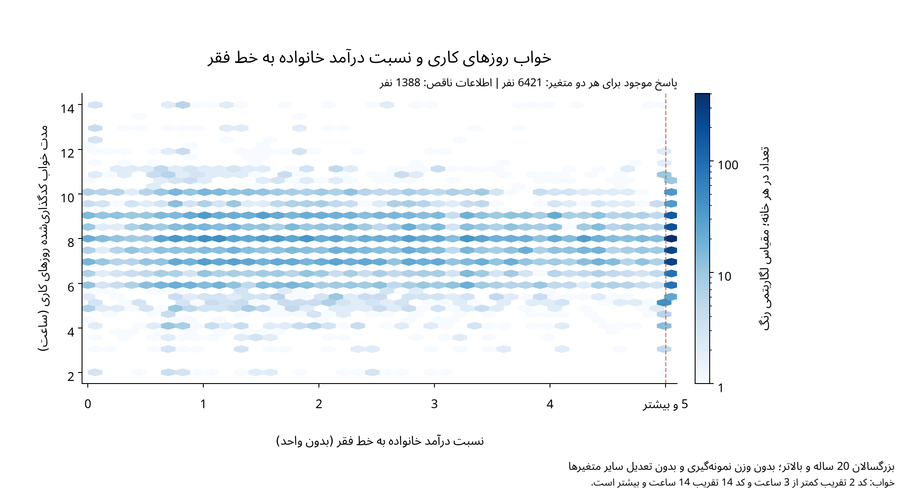

# کوواریانس مدت خواب و نسبت درآمد خانواده به خط فقر

برای هر فرد، X مدت خواب روز کاری بر حسب ساعت و Z نسبت درآمد خانواده به خط فقر است. از مقادیر منتشرشده استفاده کردیم. کدهای 2 و 14 خواب تقریب دو رده انتهایی‌اند و کد 5 درآمد نماینده نسبت 5 و بالاتر است.

از 7809 بزرگسال، 6421 نفر هر دو پاسخ را داشتند. در هر محاسبه، میانگین هر دو متغیر و کوواریانس روی همین افراد به دست آمد. 1607 نفر از این گروه در رده بالایی درآمد قرار دارند.

نمودار فاز اول پراکندگی همین زوج‌ها را با خانه‌های شش‌ضلعی نشان می‌دهد. رنگ هر خانه تعداد مشاهدات بدون وزن در آن خانه است. تجمع در سمت راست نمودار با سقف انتشار درآمد و ردیف‌های افقی با ثبت نیم‌ساعته خواب ارتباط دارند.

برای هر فرد، انحراف خواب از میانگین خواب را در انحراف نسبت درآمد از میانگین نسبت درآمد ضرب کردیم. میانگین این حاصل‌ضرب‌ها با تقسیم بر تعداد افراد، کوواریانس تجربی را می‌دهد. در نسخه وزندار، هر دو میانگین و میانگین حاصل‌ضرب با وزن مصاحبه و مخرج مجموع وزن‌ها محاسبه شدند.

| توزیع تجربی | میانگین خواب (ساعت) | میانگین نسبت درآمد | کوواریانس (ساعت × واحد نسبت درآمد) |
|---|---:|---:|---:|
| بدون وزن | 7.7081 | 2.9088 | -0.0874 |
| با وزن مصاحبه | 7.6849 | 3.0664 | -0.1047 |

علامت منفی در هر دو محاسبه نشان می‌دهد که در مجموع، نسبت درآمد بالاتر با خواب ثبت‌شده کوتاه‌تر همراه بوده است. کوواریانس به مقیاس متغیرها وابسته است. برای برآورد تغییر مدت خواب به ازای یک واحد افزایش نسبت درآمد، باید شیب رگرسیون را محاسبه کرد. این مقایسه توصیفی پیش از تعدیل سن، جنس و وضعیت تأهل است.

دستور بازتولید از ریشه پروژه: `python src/sleep_income.py`.
