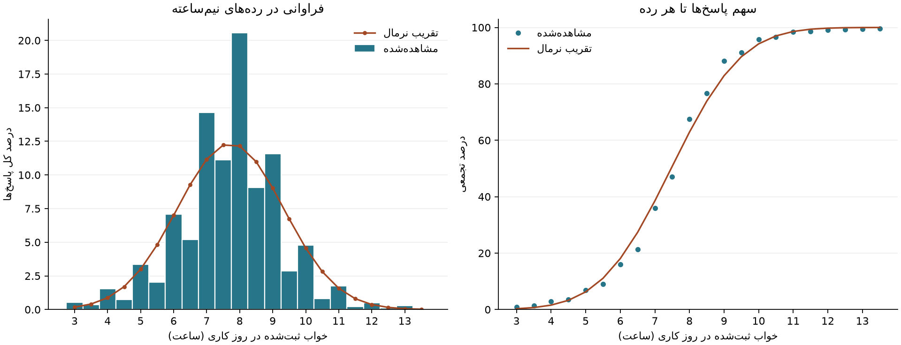

# شکل توزیع خواب روزهای کاری و تقریب نرمال

این بخش بر پایه [فراوانی‌های فاز اول](../phase1/sleep_distribution_frequencies.csv) و همه 7698 پاسخ معتبر بزرگسالان برای `SLD012` تهیه شد. اینجا توزیع خود مدت خواب را بدون وزن پیمایش بررسی می‌کنیم. میانگین 7.72 و انحراف معیار نمونه 1.61 ساعت است. منحنی مرجع نرمال با همین دو پارامتر رسم شد. مطابق فاز اول، برای محاسبه شاخص‌های عددی، کدهای 2 و 14 تقریب دو رده انتهایی هستند.

در نمودار چپ هر ستون سهم یک رده نیم‌ساعته از کل پاسخ‌هاست. رده‌های «کمتر از 3 ساعت» (33 نفر) و «14 ساعت و بیشتر» (36 نفر) پهنای مشخصی ندارند و جداگانه گزارش شده‌اند. برای مقایسه روی مقیاس یکسان، احتمال مدل نرمال را در بازه نیم‌ساعته پیرامون هر مقدار حساب کردیم. در نمودار راست، هر نقطه سهم تجمعی تا همان رده، با احتساب گروه پایین، و خط، احتمال نرمال تا لبه بالایی آن رده است.

میانه 8 ساعت و نیمه میانی پاسخ‌ها بین 7 و 8.5 ساعت است. ضریب چولگی گشتاوری مقادیر کدگذاری‌شده 0.0000 است. با معیار توصیفی 1.5 برابر دامنه میان‌چارکی، 274 پاسخ زیر 4.75 ساعت و 258 پاسخ بالای 10.75 ساعت قرار می‌گیرند. این پاسخ‌ها در تحلیل حفظ شده‌اند و طول دقیق خواب در دو رده باز قابل بازیابی نیست.

سهم رده 8 ساعت در داده 20.56 درصد است. مدل نرمال برای بازه 7.75 تا 8.25 ساعت، 12.15 درصد پیش‌بینی می‌کند. هر دو توزیع در حوالی 8 ساعت متمرکزند، اما فراوانی برخی ساعت‌های کامل از آنچه منحنی هموار نشان می‌دهد بیشتر است. تقریب نرمال برای توصیف کلی مرکز و پراکندگی مفید است. برای احتمال یک رده خواب مشخص، جدول تجربی الگوی ثبت پاسخ‌ها را بهتر حفظ می‌کند.

برای بازتولید این بخش، از ریشه مخزن `python src/sleep_normal.py` را اجرا می‌کنیم.
